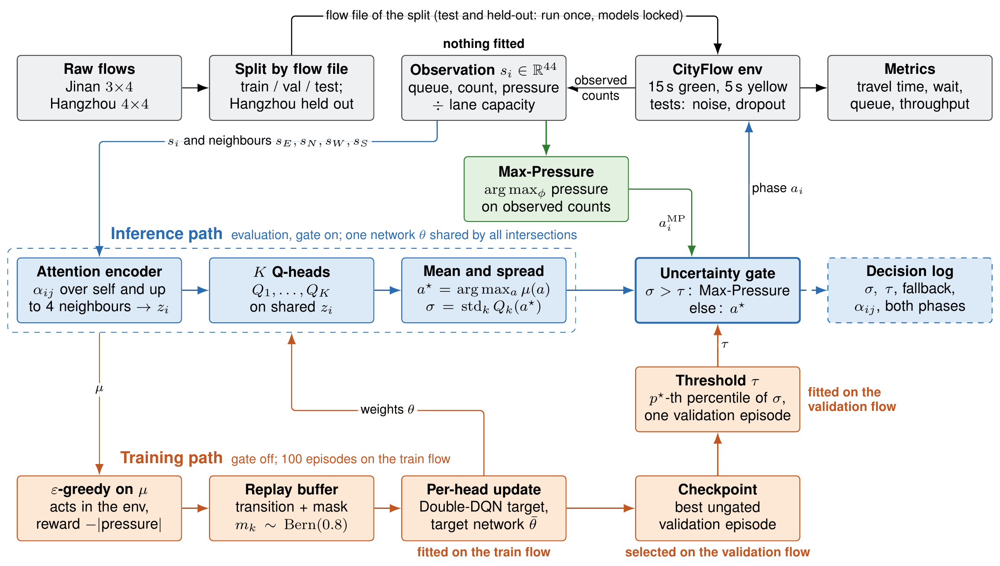
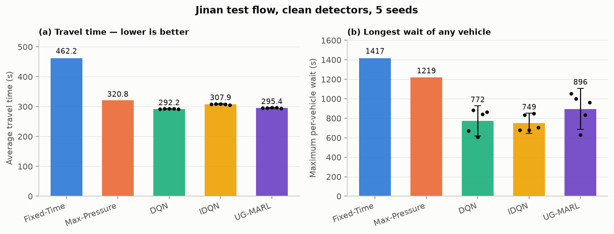

# UG-MARL: Uncertainty-Gated Multi-Agent RL for Traffic Signal Control

Every intersection in a city has to decide, every few seconds, which traffic gets green.
Reinforcement learning (RL) controllers learn this from simulation and beat hand-written
rules on average travel time. But they can't tell when one of their decisions is unreliable,
and they fall apart when the detector readings look different from what they saw in training.

This project tests a simple fix. Each intersection runs a learned controller that looks at
its own lanes and its four neighbours. The controller has several Q-value heads (an
ensemble). When the heads disagree too much, meaning the model is unsure, that intersection
hands its decision to Max-Pressure, a rule-based controller that keeps queues stable and
needs no training. The threshold for "too much" is chosen on validation data only.

Everything runs in the [CityFlow](https://github.com/cityflow-project/CityFlow) simulator on
real traffic from two Chinese cities: Jinan (12 intersections, used for training and testing)
and Hangzhou (16 intersections, never seen in training).

## How it works



The blue path is how a decision is made at test time. The intersection's observation and its
neighbours' go through an attention encoder and K Q-heads. If the spread σ of the heads is
above the threshold τ, Max-Pressure picks the phase; otherwise the model's best phase is used.
The orange path is training: the network learns on the train flow with the gate off, and
both the checkpoint and τ are chosen on the validation flow.

## Main result

On the Jinan test flow the gated model (UG-MARL) has an average travel time
of 295.4 s. That beats Max-Pressure (320.8 s) and independent DQN (307.9 s), and is 3.2 s
behind a shared DQN (292.2 s). With detector noise of 0.2 the learned controllers without a
gate climb to 759-870 s, while UG-MARL stays at 420.5 s, level with Max-Pressure. Across six
test conditions its largest gap to the best controller is 6.8 s, the smallest of the five
controllers.



## Controllers compared

| Name in the code | What it is |
|---|---|
| `fixed_time` | Cycles through the 8 phases, 30 s each |
| `max_pressure` | Gives green to the phase with the largest queue difference (Varaiya 2013) |
| `dqn` | One DQN network shared by all intersections, no coordination |
| `idqn` | One independent DQN per intersection |
| `ugmarl` | Proposed model: neighbour attention + 3 Q-heads + uncertainty gate |
| `ugmarl-nogate`, `ugmarl-noattn`, `ugmarl-noens` | Ablations: no gate, no attention, a single head (so no gate) |

## Repository layout

```
configs/      YAML settings for every run (all inherit configs/base.yaml)
src/trafficrl/
  data/       train / val / test split of the flow files, road-network parser
  envs/       CityFlow environment, observations, metrics, detector noise
  agents/     Fixed-Time, Max-Pressure, DQN, IDQN and UG-MARL
  train/      training loop and hyperparameter search
  eval/       evaluation loop, decision logs, hypothesis checks, model lock
scripts/      command-line entry points (train, tune, evaluate, ...)
notebooks/    00 data audit, 01 EDA, 02 result tables, 03 error analysis, 04 σ / attention checks
docs/         dataset card, result CSVs, figures, experiment log
models/       manifest.json: SHA-256 hashes of the final checkpoints
tests/        checks that the data split has no leakage
```

## Setup

Tested on Ubuntu 24.04 with Python 3.12 (native and WSL2). Clone into the Linux filesystem
(e.g. `~/Agentic-Traffic-Signal-Control`), not into `/mnt/...`.

```bash
sudo apt update && sudo apt install -y build-essential cmake python3-venv python3-dev git

cd ~/Agentic-Traffic-Signal-Control
python3 -m venv .venv
source .venv/bin/activate
pip install --upgrade pip setuptools wheel
pip install -r requirements.txt   # exact versions; PyTorch is a ~3 GB download
pip install -e .                  # makes `import trafficrl` work
```

CityFlow has to be built from source. Its bundled pybind11 doesn't build on Python 3.12,
so swap it for pybind11 v2.13.6:

```bash
mkdir -p ~/src && cd ~/src
git clone https://github.com/cityflow-project/CityFlow
cd CityFlow
git checkout 81ee0f47659ca66177a71f81676691c58ee89184
git submodule update --init extern/rapidjson
rm -rf extern/pybind11
git clone --depth 1 --branch v2.13.6 https://github.com/pybind/pybind11 extern/pybind11
pip install .                     # with the project's .venv active
python -c "import cityflow; print(cityflow.__file__)"
```

If `cmake` isn't installed system-wide, run `pip install cmake==3.28.3` and then
`pip install --no-build-isolation .` instead.

Training runs on the CPU (faster than the GPU for these small networks). Each training run
uses about 0.9 GB of RAM.

## Data

The Jinan and Hangzhou flows come from the CoLight repository (commit `04440b7`):

```bash
cd ~/Agentic-Traffic-Signal-Control
mkdir -p data/raw && cd data/raw
git clone --depth 1 --filter=blob:none --sparse https://github.com/wingsweihua/colight colight_src
cd colight_src && git sparse-checkout set data/Jinan data/Hangzhou
```

The data comes without a license file. Use it for academic work only and cite
CoLight (Wei et al., CIKM 2019).

`data/processed/splits.json` assigns whole flow files to splits and pins each file
by its SHA-256 hash. Loading goes through `trafficrl.data.splits.flow_files`, which refuses a
file whose hash doesn't match.

| Split | Files | Used for |
|---|---|---|
| train | Jinan `real` | training |
| val | Jinan `real_2000` | checkpoint, hyperparameter and gate-threshold selection |
| test | Jinan `real_2500` | final evaluation, run once |
| heldout | Hangzhou, 3 flows | zero-shot test on an unseen city, run once |

The scripts refuse `test` and `heldout` unless you pass `--final`. More detail is in
`docs/dataset_card.md`.

## Reproducing the results

The steps below run in order. Training and evaluation write to `results/`, which isn't in
the repository because it's large, and append a row per run to `docs/experiment_log.csv`.
The notebooks in steps 6-8 only read `results/`, so you can re-run them as often as you like.

Rule-based controllers are deterministic, so their numbers come out exactly. The learned
models are seeded (seeds 0-4) and use deterministic PyTorch kernels, so a re-run on the same
machine and software gives the same numbers. On other hardware, expect the learned models'
means to land within about one standard deviation of the values below.

### 0. Data audit (~10 s)

```bash
jupyter nbconvert --to notebook --execute --inplace notebooks/00_data_audit.ipynb
```

Checks every flow file and both road networks for missing fields, wrong types, duplicates and
impossible routes, and stops if any count is not 0. Expected: 0 defects. Writes
`docs/data_audit.json` and, for the training flow only, `docs/figures/audit/*.png`.

### 1. EDA (training flow only, ~3 min)

```bash
jupyter nbconvert --to notebook --execute --inplace notebooks/01_eda_train.ipynb
```

Writes `docs/figures/eda/*.png`. Expected: Max-Pressure on the training flow scores 451 / 375
/ 344 / 347 s at a decision interval of 5 / 10 / 15 / 20 s, which is why 15 s is used
throughout. The data-quality table reads `docs/data_audit.json` from step 0.

### 2. Rule baselines on validation (~1 min)

```bash
python scripts/evaluate.py --agent fixed_time   --split val
python scripts/evaluate.py --agent max_pressure --split val
```

Expected average travel time: Fixed-Time 434.8 s, Max-Pressure 326.1 s (identical for
every seed).

### 3. DQN and IDQN: tune, then train 5 seeds

```bash
# 8 random trials each from configs/search/rl_baselines.yaml (validation flow)
python scripts/tune.py --search configs/search/rl_baselines.yaml --agent dqn  --workers 4
python scripts/tune.py --search configs/search/rl_baselines.yaml --agent idqn --workers 4
# the chosen settings are already in configs/dqn.yaml and configs/idqn.yaml
python scripts/tune.py --config configs/dqn.yaml  --seeds 0 1 2 3 4 --workers 5
python scripts/tune.py --config configs/idqn.yaml --seeds 0 1 2 3 4 --workers 5
python scripts/evaluate.py --config configs/eval_rl_baselines.yaml --agent dqn --split val \
    --checkpoint 'results/train/dqn_final_s{seed}/checkpoints/best.pt'
python scripts/evaluate.py --config configs/eval_rl_baselines.yaml --agent idqn --split val \
    --checkpoint 'results/train/idqn_final_s{seed}/checkpoints/best.pt'
```

One training run takes 15-25 min on a CPU. Each seed's checkpoint is chosen on validation and
saved as `results/train/<model>_final_s<seed>/checkpoints/best.pt`. Expected validation travel
time: DQN 299.8 ± 1.0 s, IDQN 312.7 ± 2.5 s.

### 4. UG-MARL: tune, train, calibrate the gate

```bash
# grid over ensemble size K {3, 5, 10} x attention width d {32, 64, 128}; winner K=3, d=128
python scripts/tune.py --search configs/search/ugmarl.yaml --agent ugmarl --workers 5
# full model and the two retrained ablations, 5 seeds each
python scripts/tune.py --config configs/ugmarl.yaml        --seeds 0 1 2 3 4 --workers 5
python scripts/tune.py --config configs/ugmarl_noattn.yaml --seeds 0 1 2 3 4 --workers 5
python scripts/tune.py --config configs/ugmarl_noens.yaml  --seeds 0 1 2 3 4 --workers 5
# gate threshold per model: p-th percentile of σ on a clean validation episode
python scripts/calibrate_gate.py --search configs/search/ugmarl_gate.yaml \
    --config configs/eval_ugmarl.yaml --workers 5
python scripts/calibrate_gate.py --search configs/search/ugmarl_gate.yaml \
    --config configs/eval_ugmarl.yaml --workers 5 agents.ugmarl.use_attention=false
```

The gate only acts at evaluation time; training and checkpoint selection run without it.
Calibration writes `gate.json` next to each checkpoint and
`docs/results/gate_calibration{,_noattn}.csv`. Expected: p = 80 is chosen (mean 343.7 s over
seeds and the five detector conditions; no gate: 485.2 s).

### 5. Validation runs of every model

```bash
python scripts/robustness.py --spec configs/robustness_val.yaml --workers 5
C=configs/eval_ugmarl.yaml
python scripts/evaluate.py --config $C --agent ugmarl --split val --log-decisions \
    --checkpoint 'results/train/ugmarl_final_s{seed}/checkpoints/best.pt'
python scripts/evaluate.py --config $C --agent ugmarl --split val --log-decisions \
    --checkpoint 'results/train/ugmarl_final_s{seed}/checkpoints/best.pt' agents.ugmarl.use_gate=false
python scripts/evaluate.py --config $C --agent ugmarl --split val --log-decisions \
    --checkpoint 'results/train/ugmarl-noattn_final_s{seed}/checkpoints/best.pt' agents.ugmarl.use_attention=false
python scripts/evaluate.py --config $C --agent ugmarl --split val --log-decisions \
    --checkpoint 'results/train/ugmarl-noens_final_s{seed}/checkpoints/best.pt' agents.ugmarl.use_ensemble=false
```

The first command writes `docs/results/val_robustness.csv` (every controller under detector
noise and dropout). Expected validation travel time, UG-MARL: 302.3 ± 1.1 s.

### 6. Final test and Hangzhou (run once)

```bash
python scripts/lock_models.py --write    # hash the checkpoints into models/manifest.json
python scripts/robustness.py --spec configs/final_test.yaml    --final --workers 1 --results-dir results/final
python scripts/robustness.py --spec configs/final_heldout.yaml --final --workers 1 --results-dir results/final
jupyter nbconvert --to notebook --execute --inplace notebooks/02_results.ipynb
```

`--final` checks the checkpoints against `models/manifest.json` first, so a model can't be
swapped after it was locked. The test run has 240 episodes (~30 min) and the Hangzhou run
has 105 (~15 min). Both use one process so the decision-latency numbers are clean.

Notebook 02 writes the learning curves and every table in `docs/results/`, then prints the
hypothesis verdicts. Expected (average travel time, clean test flow, mean ± std over 5 seeds):

| Model | Test | Noise 0.2 | Hangzhou (all flows) |
|---|---|---|---|
| Fixed-Time | 462.2 | 462.2 | 667.5 |
| Max-Pressure | 320.8 | 413.7 | 431.8 |
| DQN | 292.2 ± 0.6 | 828.2 | 410.4 ± 7.1 |
| IDQN | 307.9 ± 1.4 | 758.9 | can't transfer* |
| UG-MARL | 295.4 ± 1.1 | 420.5 | 410.0 ± 2.9 |

\* IDQN has one network per Jinan intersection, so it can't run on Hangzhou's 16.

Verdicts: H1 supported, H2 supported, H3 not supported.

### 7. Error analysis (reads the logs, ~1 min)

```bash
python scripts/tau_sweep.py --search configs/search/tau_sensitivity.yaml --workers 5   # ~25 min
jupyter nbconvert --to notebook --execute --inplace notebooks/03_error_analysis.ipynb
```

The τ sweep tries thresholds p = 50, 60, 70 on validation and writes
`docs/results/tau_sensitivity.csv`. Expected: 343.2 / 343.8 / 342.3 s against 343.7 s at
p = 80; nothing is re-selected. Notebook 03 first recomputes travel time from the logs
of all 305 final episodes. It stops if any episode differs from the saved metrics by more
than 0.001 s (expected largest difference: 0.00005 s). It writes
`docs/figures/results/*.png` and `docs/results/error_analysis_*.csv`.

### 8. σ and attention checks (validation, ~3 min)

```bash
jupyter nbconvert --to notebook --execute --inplace notebooks/04_gate_attention.ipynb
```

Writes `docs/results/sigma_validity{,_td}.csv`, `docs/results/attention_faithfulness.csv`,
`docs/figures/ugmarl/sigma_validity.png` and `docs/figures/results/attention_faithfulness.png`.
Expected: σ hardly tracks the TD error (Spearman ρ between −0.02 and 0.06 per seed). Swapping
the input of the neighbour with the highest attention weight moves Q by 0.0061, the
lowest-weight neighbour 0.0022 and the intersection's own input 0.0415.

## Where each table and figure comes from

| Output | Made by |
|---|---|
| `docs/figures/eda/*.png` | `notebooks/01_eda_train.ipynb` |
| `docs/figures/training/learning_curves.png` | `notebooks/02_results.ipynb` |
| `docs/results/val_phase6.csv`, `test_*.csv`, `heldout_generalisation*.csv` | `notebooks/02_results.ipynb` |
| `docs/results/val_robustness.csv` | `scripts/robustness.py --spec configs/robustness_val.yaml` |
| `docs/results/gate_calibration*.csv` | `scripts/calibrate_gate.py` |
| `docs/results/tau_sensitivity.csv` | `scripts/tau_sweep.py` |
| `docs/figures/results/*.png`, `docs/results/error_analysis_*.csv` | `notebooks/03_error_analysis.ipynb` |
| `docs/results/sigma_validity*.csv`, `attention_faithfulness.csv` and their figures | `notebooks/04_gate_attention.ipynb` |
| `docs/data_audit.json`, `docs/figures/audit/*.png` | `notebooks/00_data_audit.ipynb` |

## Tests and lint

```bash
pytest                         # data split: structure, no leakage, pinned hashes
ruff check src tests scripts
```

## Credits

Traffic data from CoLight (Wei et al., CIKM 2019); simulator CityFlow (Zhang et al., WWW 2019);
Max-Pressure from Varaiya (2013).
