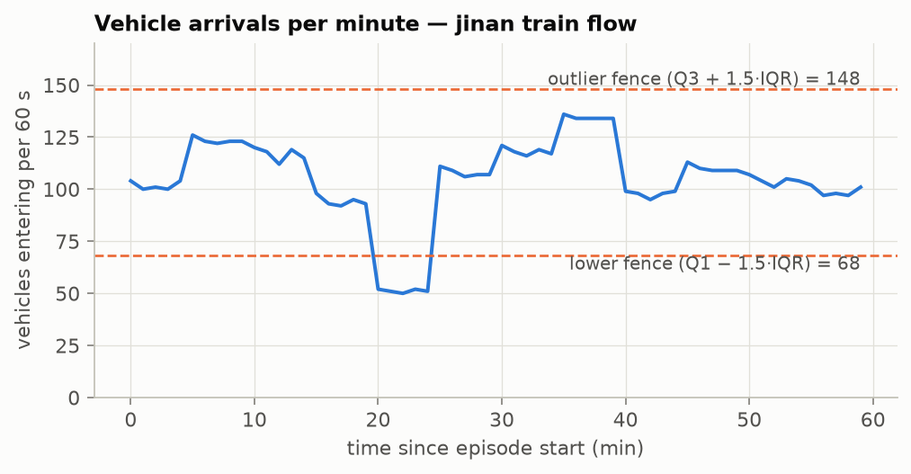
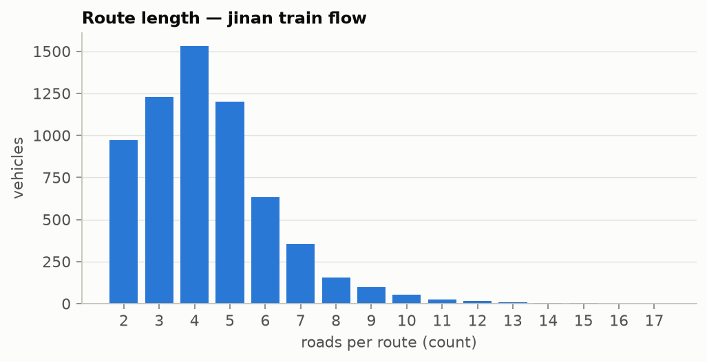
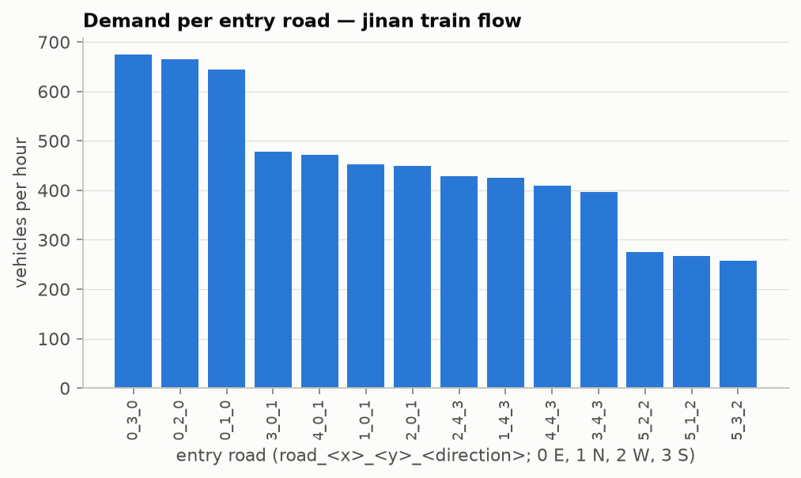

# Data audit — Jinan (primary) and Hangzhou (held-out)

ROADMAP 3.0 · guidelines G3 · **generated by `python scripts/audit_data.py`** — do not edit by hand; change the script and re-run. Machine-readable copy: `docs/data_audit.json`. Checks are implemented in `src/trafficrl/data/audit.py` and tested in `tests/data/test_audit.py`.

## 1. Scope and method

- **Files:** 6 flow files (32659 vehicle records) and 2 road networks, all verified against the SHA-256 hashes in `data/processed/splits.json` before auditing.
- **Structural checks only.** Every check counts records that are missing, duplicated or impossible. Nothing is fitted, and no file is edited or filtered: the flow files are hash-pinned benchmark data, so a defect would be handled by a dated Decision Log entry, not by silent cleaning.
- **Leakage rule.** Counts are reported for every split. Demand *distributions* and plots (§5–§6) are shown for the **train split only**; validation, test and the held-out city get counts only (`.claude/reference/database.md`, rules 7 and 9).
- **Episode:** 3600 s; arrivals are binned in 60 s windows for the outlier check.

## 2. Result

**No defects: all 17 flow checks and 12 road-network checks return 0 on every file.** The data is used as released.

Three properties of the data are reported for information (§4): trips that end inside the network, routes that pass an intersection twice, and arrival bursts.

## 3. Defect counts (expected: 0)

### 3.1 Flow files

| Check | jinan train `jinan_real` | jinan val `jinan_real_2000` | jinan test `jinan_real_2500` | hangzhou heldout `hangzhou_real` | hangzhou heldout `hangzhou_real_5734` | hangzhou heldout `hangzhou_real_5816` |
|---|---|---|---|---|---|---|
| `missing_field` | 0 | 0 | 0 | 0 | 0 | 0 |
| `missing_vehicle_field` | 0 | 0 | 0 | 0 | 0 | 0 |
| `wrong_type` | 0 | 0 | 0 | 0 | 0 | 0 |
| `duplicate_records` | 0 | 0 | 0 | 0 | 0 | 0 |
| `start_time_out_of_range` | 0 | 0 | 0 | 0 | 0 | 0 |
| `start_time_not_integer` | 0 | 0 | 0 | 0 | 0 | 0 |
| `end_before_start` | 0 | 0 | 0 | 0 | 0 | 0 |
| `multi_vehicle_records` | 0 | 0 | 0 | 0 | 0 | 0 |
| `route_too_short` | 0 | 0 | 0 | 0 | 0 | 0 |
| `unknown_road` | 0 | 0 | 0 | 0 | 0 | 0 |
| `disconnected_route` | 0 | 0 | 0 | 0 | 0 | 0 |
| `route_not_from_boundary` | 0 | 0 | 0 | 0 | 0 | 0 |
| `route_repeats_road` | 0 | 0 | 0 | 0 | 0 | 0 |
| `nonpositive_vehicle_value` | 0 | 0 | 0 | 0 | 0 | 0 |
| `speed_above_lane_limit` | 0 | 0 | 0 | 0 | 0 | 0 |
| `unexpected_field` | 0 | 0 | 0 | 0 | 0 | 0 |
| `unexpected_string_value` | 0 | 0 | 0 | 0 | 0 | 0 |

What the checks mean:

- **Missing values:** `missing_field` (one of `vehicle`, `route`, `interval`, `startTime`, `endTime` absent or null), `missing_vehicle_field` (one of the 9 vehicle parameters), `wrong_type`.
- **Duplicates:** `duplicate_records` — exact duplicate records. The files contain no vehicle ID (CityFlow generates `flow_<i>_<j>` IDs when it loads a file), so duplicate IDs cannot occur; duplicate *records* are the equivalent check.
- **Impossible values:** start time outside `[0, episode)` or not an integer; `endTime` before `startTime`; a record that generates more than one vehicle; route shorter than 2 roads; a road that is not in the road network; consecutive roads with no permitted movement between them (`disconnected_route`); a route that does not start at a boundary node or uses the same road twice; non-positive vehicle length, width, acceleration, gap, speed or headway; vehicle speed above the lane limit.
- **Privacy:** `unexpected_field` (any key outside the documented data dictionary, e.g. a plate or device ID) and `unexpected_string_value` (free text such as a date).

### 3.2 Road networks

| Check | jinan `roadnet_3_4.json` | hangzhou `roadnet_4_4.json` |
|---|---|---|
| `intersection_without_4_in_roads` | 0 | 0 |
| `intersection_without_4_out_roads` | 0 | 0 |
| `intersection_without_12_movements` | 0 | 0 |
| `intersection_without_9_phases` | 0 | 0 |
| `transition_phase_not_5s` | 0 | 0 |
| `invalid_phase_movement_index` | 0 | 0 |
| `unknown_movement_type` | 0 | 0 |
| `lane_link_index_out_of_range` | 0 | 0 |
| `road_with_unknown_intersection` | 0 | 0 |
| `movement_with_unknown_road` | 0 | 0 |
| `nonpositive_road_length` | 0 | 0 |
| `nonpositive_lane_value` | 0 | 0 |

Sizes: jinan — 12 signalised + 14 virtual intersections, 62 roads, 186 lanes; hangzhou — 16 signalised + 16 virtual intersections, 80 roads, 240 lanes. Every signalised intersection has 4 incoming and 4 outgoing roads, 12 movements and 9 light phases (phase 0 = 5 s transition), which is what the feature builder and the environment assume.

## 4. Information counts (not defects)

| Item | jinan train `jinan_real` | jinan val `jinan_real_2000` | jinan test `jinan_real_2500` | hangzhou heldout `hangzhou_real` | hangzhou heldout `hangzhou_real_5734` | hangzhou heldout `hangzhou_real_5816` |
|---|---|---|---|---|---|---|
| `records` (vehicles) | 6295 | 4365 | 5494 | 2983 | 6538 | 6984 |
| `vehicle_profiles` (distinct parameter sets) | 1 | 1 | 1 | 1 | 1 | 1 |
| `route_ends_inside_network` | 77 (1.2 %) | 54 (1.2 %) | 70 (1.3 %) | 55 (1.8 %) | 124 (1.9 %) | 124 (1.8 %) |
| `route_revisits_intersection` | 208 (3.3 %) | 160 (3.7 %) | 189 (3.4 %) | 130 (4.4 %) | 277 (4.2 %) | 293 (4.2 %) |
| `arrival_burst_bins` (of 60) | 0 | 0 | 0 | 5 | 0 | 0 |
| `arrival_low_bins` (of 60) | 5 | 0 | 0 | 0 | 0 | 0 |
| `same_second_same_entry_lane` | 0 | 0 | 0 | 0 | 0 | 0 |

Interpretation:

- **Trips ending inside the network (1–2 % of every file).** The last road of the route ends at a signalised intersection, not at a boundary node. CityFlow accepts this: the vehicle is removed when it reaches the end of its last road, and its travel time is counted like any other. These are trips whose destination lies inside the area. **Kept as released.**
- **Routes passing an intersection twice (3–4 %).** Detours or loops in the recorded trips (no road is used twice — `route_repeats_road` is 0). They are legal routes and part of the published benchmark. **Kept as released**; they make those vehicles' travel times long under every controller, so they affect all methods equally.
- **Arrival outliers.** A minute is flagged as a burst when its count is above Q3 + 1.5·IQR of the file's own per-minute counts, and as a low bin when it is below Q1 − 1.5·IQR. Flagged bins are reported, not removed: peaks and troughs are real traffic, and handling them is the controller's job.
- **Same-second arrivals on one entry lane: 0 in every file**, so every vehicle can be inserted at its recorded start time when the entry lane has space.
- **One vehicle profile per file:** all vehicles share the same length, speed and acceleration, so the data has a single vehicle class.

## 5. Demand description — jinan train split only

*Figure A1. Vehicles entering the network per 60 s over the 3600 s episode (jinan train flow, 6295 vehicles). Dashed lines: outlier fences Q3 + 1.5·IQR and Q1 − 1.5·IQR.*

**Interpretation.** Arrivals range from 50 to 136 vehicles per minute (mean 104.9, median 106); the busiest minute starts at minute 35. No minute is above the upper fence (148), so the hour has no arrival burst. 5 minutes are below the lower fence (68): a five-minute trough in which demand roughly halves. The curve is step-shaped, constant over five-minute blocks, which suggests the released trips were built from five-minute counts. Both are kept: the trough is a short low-demand period, not an error, and it gives the controllers one visible change of regime within the hour.

*Figure A2. Number of roads per vehicle route.*

**Interpretation.** Routes have 2–17 roads (mean 4.37, median 4, 95th percentile 8). Most trips are short and cross only a few signalised intersections; the long tail is the small group of detour routes counted in §4.

*Figure A3. Vehicles per hour entering at each boundary road, sorted.*

**Interpretation (bias / coverage).** 14 of 14 boundary roads carry demand. Demand is uneven: the five busiest entries carry 47 % of all vehicles (largest `road_0_3_0`: 675; smallest `road_5_3_2`: 257). Movements are 57 % through, 14 % left and 28 % right; 0 of 144 movements are never used. Intersection load ranges from 1477 (`intersection_4_3`) to 2058 (`intersection_1_1`) vehicles per hour. Every movement is used, so no part of the state space is empty in training, but the load is unbalanced (busiest entry 2.6× the quietest). Consequence: lightly used approaches can be starved by a controller that only minimises the average, which is why the maximum wait per vehicle is reported next to the average travel time.

## 6. Privacy

- Records contain only the five documented fields; the `unexpected_field` and `unexpected_string_value` checks are 0 on every file.
- No vehicle ID, licence plate, device ID, calendar date or location trace of a person: a record is a start second (0–3599) and a list of road IDs on a grid. File names are prefixed `anon_`.
- All vehicles share one parameter profile, so no record can be linked to a vehicle type or owner.

## 7. Handling and limits of this audit

- **Handling:** the data is used exactly as released. Nothing is removed, repaired or resampled.
- **Held-out city and Jinan val / test:** only the counts above. Their demand distributions are not plotted or described before final testing.
- **Not covered:** how the trips were reconstructed from camera records, and the collection dates — neither is documented in the release (dataset card §2, §6).
