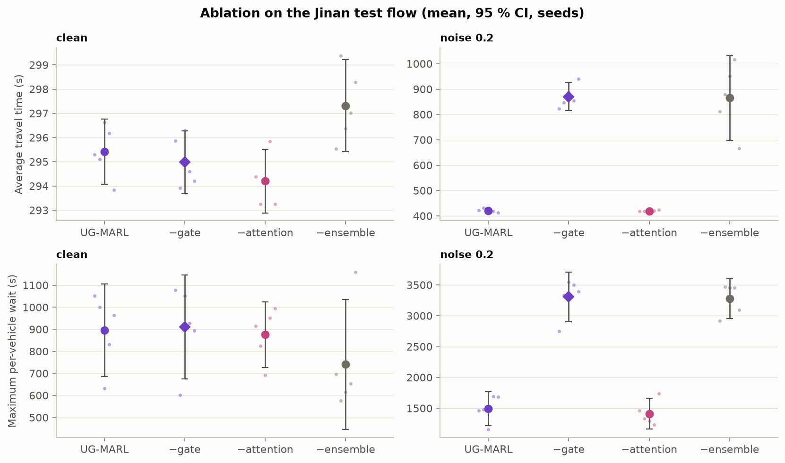

# Figure — ablation of gate, attention and ensemble

**Caption.** Full UG-MARL and its three ablations on the Jinan test flow, clean and with detector noise 0.2. Points: mean over seeds 0–4; bars: 95 % CI; small dots: seeds. −gate uses the same checkpoints as the full model (diamond); −attention and −ensemble are trained separately. The y axes do not start at 0.

**Values.** UG-MARL / clean / avg: 295.4; UG-MARL −gate / clean / avg: 295.0; UG-MARL −attention / clean / avg: 294.2; UG-MARL −ensemble / clean / avg: 297.3; UG-MARL / noise 0.2 / avg: 420.5; UG-MARL −gate / noise 0.2 / avg: 870.2; UG-MARL −attention / noise 0.2 / avg: 419.3; UG-MARL −ensemble / noise 0.2 / avg: 864.9; UG-MARL / clean / max: 895.8; UG-MARL −gate / clean / max: 910.4; UG-MARL −attention / clean / max: 875.6; UG-MARL −ensemble / clean / max: 740.2; UG-MARL / noise 0.2 / max: 1493.2; UG-MARL −gate / noise 0.2 / max: 3305.8; UG-MARL −attention / noise 0.2 / max: 1410.4; UG-MARL −ensemble / noise 0.2 / max: 3279.0. Source: `docs/results/test_ablation.md`.

**Interpretation.** See `docs/analysis.md` and `notebooks/02_analysis.ipynb`. Attention weights, σ and gate statistics are associations, not causes.
