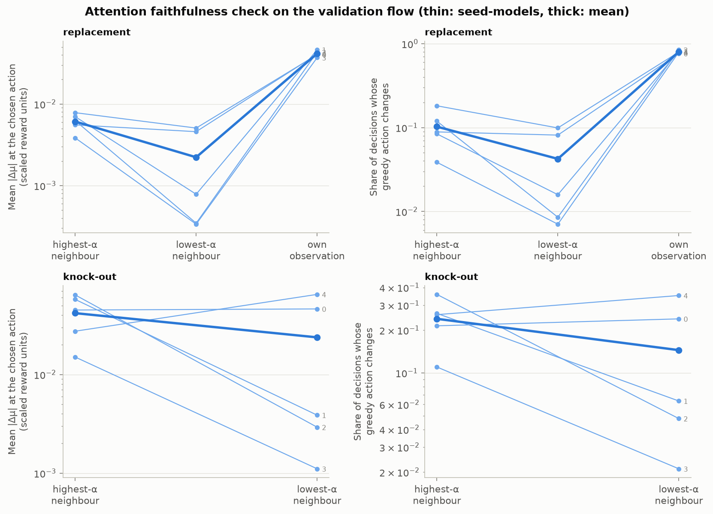

# Figure — attention faithfulness check (validation)

**Caption.** Change in the network's output when one input slot of a decision is perturbed: the neighbour with the highest attention weight, the one with the lowest, and — as an upper reference — the intersection's own observation. Replacement = the slot's 44 values are swapped for the same slot's values from another decision of the same intersection in the same episode (8 draws); knock-out = the slot is masked as absent. One clean validation episode per seed-model, decisions with ≥ 2 neighbours; log y axes. An association check on validation data.

**Values.** replacement / abs_dmu: hi 0.0061, lo 0.0022, self 0.0415; replacement / flip: hi 0.1025, lo 0.0424, self 0.8011; knock-out / abs_dmu: hi 0.0418, lo 0.0238; knock-out / flip: hi 0.2405, lo 0.1447.

**Interpretation.** See `docs/analysis.md` and `notebooks/02_analysis.ipynb`. Attention weights, σ and gate statistics are associations, not causes.
