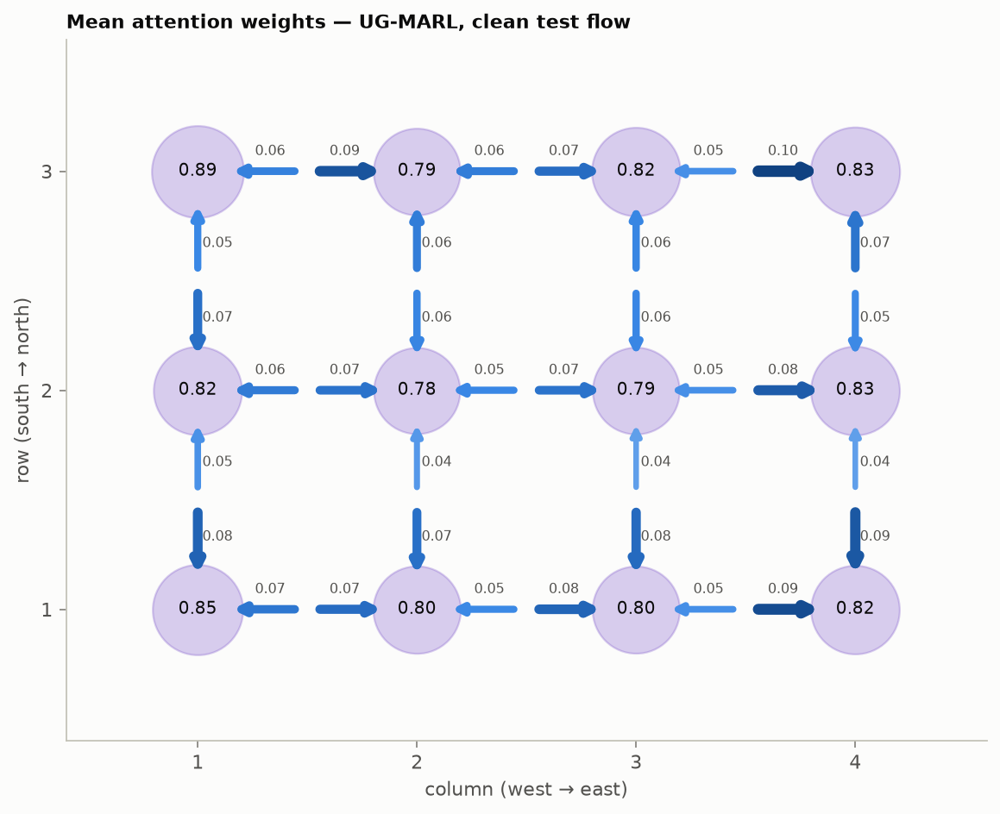

# Figure — attention weights on the network

**Caption.** Mean attention weight of every intersection on itself (number in the circle; circle area ∝ weight) and on each existing neighbour (arrow from the neighbour, width and shade ∝ weight), over all decisions of the five seed-models on the clean Jinan test flow. The weights show where the encoder looks; they are not a measure of a neighbour's influence on the chosen phase (see the faithfulness check).

**Values.** Mean over intersections: self 0.817, E 0.056, N 0.069, W 0.081, S 0.051.

**Interpretation.** See `docs/analysis.md` and `notebooks/02_analysis.ipynb`. Attention weights, σ and gate statistics are associations, not causes.
