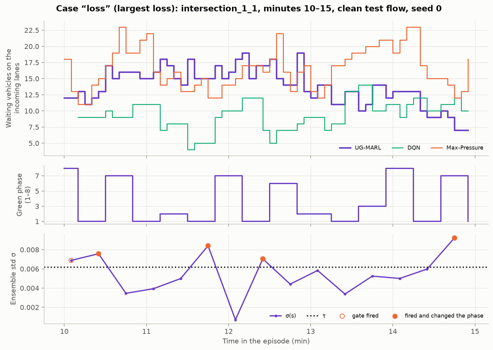

# Figure — representative case — largest loss

**Caption.** One intersection and one 5-minute window of the clean Jinan test flow, seed 0 (the UG-MARL seed with the median clean travel time; baselines of the same seed number, which are separate episodes with their own traffic). Top: waiting vehicles on the incoming lanes. Middle: UG-MARL's green phase. Bottom: σ of each UG-MARL decision against τ; open circles = gate fired, filled = the fallback changed the phase. The case was picked by the rule fixed in the plan (A7), not by eye; it illustrates, the tables carry the evidence.

**Values.** intersection_1_1, window 2; diff_wait_veh_s = 1325; decisions 15, gate fired 5, changed the phase 4.

**Interpretation.** See `docs/analysis.md` and `notebooks/02_analysis.ipynb`. Attention weights, σ and gate statistics are associations, not causes.
