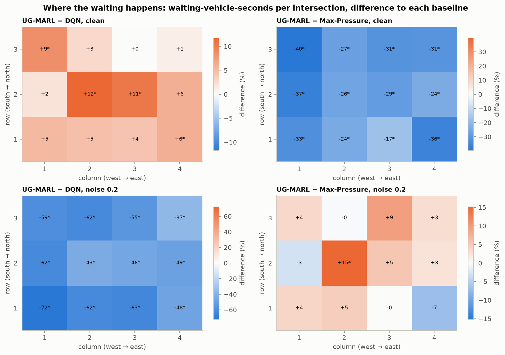

# Figure — difference in waiting per intersection

**Caption.** Waiting-vehicle-seconds (Σ over the episode of waiting vehicles on the incoming lanes × seconds) of UG-MARL minus the baseline's, in percent of the baseline, per intersection at its place in the network; blue = fewer waiting vehicles than the baseline, orange = more. Mean over seeds 0–4; * = the 95 % CI of the difference excludes 0. Jinan test flow, read from the saved traces.

**Values.** vs DQN / clean: network +5.5 %, 4 of 12 intersections clear; vs Max-Pressure / clean: network -30.4 %, 12 of 12 intersections clear; vs DQN / noise 0.2: network -57.5 %, 12 of 12 intersections clear; vs Max-Pressure / noise 0.2: network +3.5 %, 1 of 12 intersections clear.

**Interpretation.** See `docs/analysis.md` and `notebooks/02_analysis.ipynb`. Attention weights, σ and gate statistics are associations, not causes.
