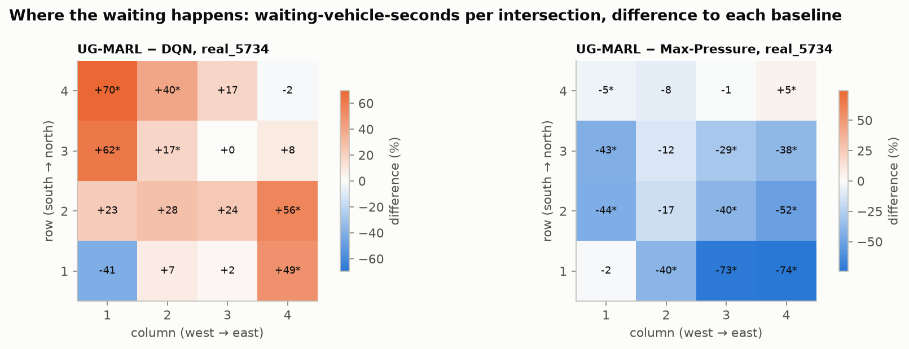

# Figure — difference in waiting per intersection

**Caption.** Waiting-vehicle-seconds (Σ over the episode of waiting vehicles on the incoming lanes × seconds) of UG-MARL minus the baseline's, in percent of the baseline, per intersection at its place in the network; blue = fewer waiting vehicles than the baseline, orange = more. Mean over seeds 0–4; * = the 95 % CI of the difference excludes 0. Jinan test flow, read from the saved traces.

**Values.** vs DQN / real_5734: network +21.6 %, 6 of 16 intersections clear; vs Max-Pressure / real_5734: network -23.5 %, 11 of 16 intersections clear.

**Interpretation.** See `docs/analysis.md` and `notebooks/02_analysis.ipynb`. Attention weights, σ and gate statistics are associations, not causes.
