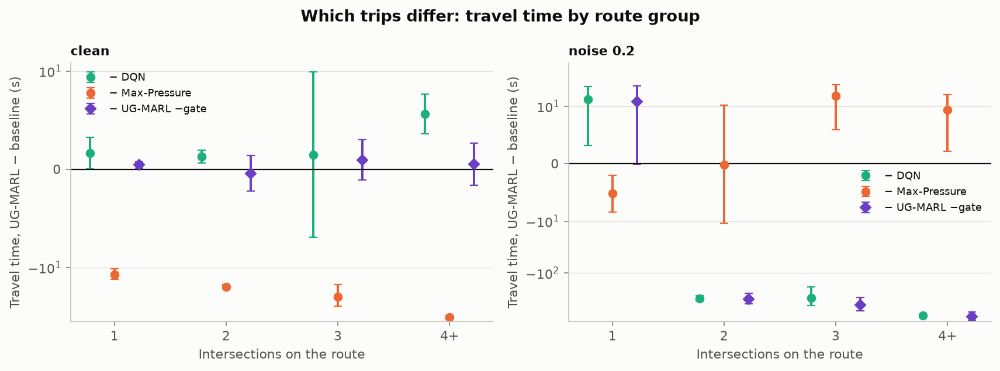

# Figure — difference in travel time by route group

**Caption.** Mean travel time per route group, UG-MARL minus each baseline (below 0 = UG-MARL faster); mean over seeds 0–4, 95 % CI; symmetric-log y axis. Routes come from the test flow file, joined to the saved per-vehicle logs by flow index (read-only, Decision Log 13 Nov).

**Values.** vs DQN / clean: 1 +1.6, 2 +1.3, 3 +1.5, 4+ +5.6; vs Max-Pressure / clean: 1 -12.0, 2 -16.5, 3 -21.4, 4+ -36.7; vs UG-MARL −gate / clean: 1 +0.4, 2 -0.4, 3 +1.0, 4+ +0.5; vs DQN / noise 0.2: 1 +13.6, 2 -313.4, 3 -309.0, 4+ -667.8; vs Max-Pressure / noise 0.2: 1 -5.2, 2 -0.2, 3 +16.0, 4+ +9.4; vs UG-MARL −gate / noise 0.2: 1 +12.4, 2 -323.4, 3 -420.9, 4+ -700.5.

**Interpretation.** See `docs/analysis.md` and `notebooks/02_analysis.ipynb`. Attention weights, σ and gate statistics are associations, not causes.
