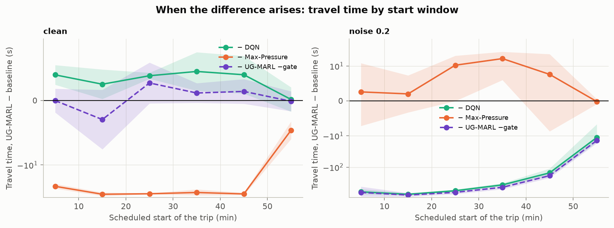

# Figure — difference in travel time by start window

**Caption.** Mean travel time of the trips scheduled to start in each 10-minute window, UG-MARL minus each baseline (below 0 = UG-MARL faster). Mean over seeds 0–4 with 95 % CI band; symmetric-log y axis (linear within ±10 s). Travel time counts from the scheduled start, so time blocked outside the network and trips unfinished at 3600 s are included, as in the simulator's average.

**Values.** vs DQN / clean: +4.0, +2.5, +3.8, +4.5, +4.0, +0.2; vs Max-Pressure / clean: -23.3, -32.0, -31.4, -29.8, -31.6, -4.6; vs UG-MARL −gate / clean: -0.0, -3.0, +2.7, +1.2, +1.4, -0.1; vs DQN / noise 0.2: -611.5, -731.7, -563.1, -366.1, -151.7, -11.3; vs Max-Pressure / noise 0.2: +2.6, +2.0, +10.6, +17.2, +7.6, -0.2; vs UG-MARL −gate / noise 0.2: -638.1, -772.3, -633.9, -438.3, -186.8, -14.1.

**Interpretation.** See `docs/analysis.md` and `notebooks/02_analysis.ipynb`. Attention weights, σ and gate statistics are associations, not causes.
