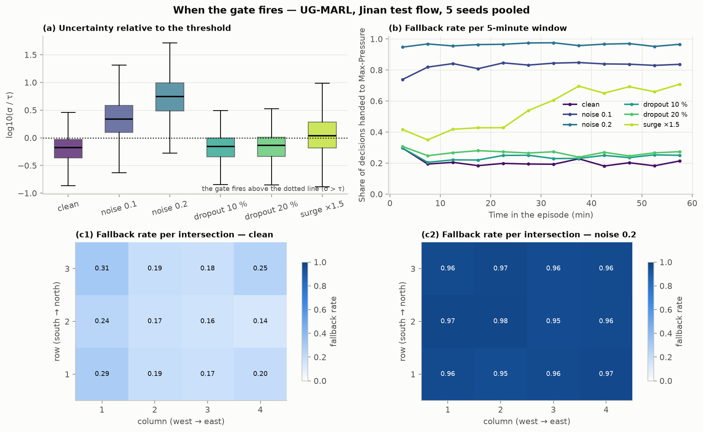

# Figure — when and where the uncertainty gate fires

**Caption.** (a) Ensemble disagreement σ of every decision divided by that model's threshold τ (boxes: quartiles; whiskers 1.5 IQR; outliers hidden). (b) Share of decisions handed to Max-Pressure per 5-minute window. (c) The same share per intersection, drawn at the intersection's place in the 3 × 4 network. Seeds 0–4 pooled; τ per seed-model from Jinan validation (p* = 80).

**Values.** clean: fallback 0.206; noise 0.1: fallback 0.826; noise 0.2: fallback 0.963; dropout 10 %: fallback 0.241; dropout 20 %: fallback 0.267; surge ×1.5: fallback 0.549. Source: `decisions_s*.csv` (= `docs/results/test_safety_explain.md`).

**Interpretation.** See `docs/analysis.md` and `notebooks/02_analysis.ipynb`. Attention weights, σ and gate statistics are associations, not causes.
