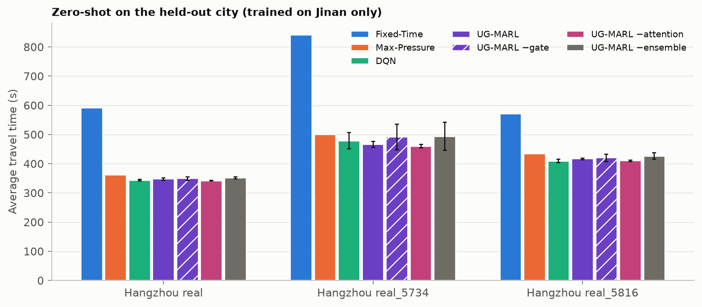

# Figure — zero-shot generalisation to Hangzhou

**Caption.** Average travel time on the three Hangzhou flow files (4 × 4 network), models trained and calibrated on Jinan only (τ from Jinan validation). Bars: mean over seeds 0–4; error bars: 95 % CI. IDQN is not transferable (one network per Jinan intersection).

**Values.** Fixed-Time / real: 590.5; Fixed-Time / real_5734: 841.7; Fixed-Time / real_5816: 570.2; Max-Pressure / real: 360.7; Max-Pressure / real_5734: 500.0; Max-Pressure / real_5816: 434.7; DQN / real: 343.4; DQN / real_5734: 478.7; DQN / real_5816: 409.1; UG-MARL / real: 347.3; UG-MARL / real_5734: 466.4; UG-MARL / real_5816: 416.3; UG-MARL −gate / real: 348.9; UG-MARL −gate / real_5734: 491.7; UG-MARL −gate / real_5816: 419.8; UG-MARL −attention / real: 341.5; UG-MARL −attention / real_5734: 460.2; UG-MARL −attention / real_5816: 409.6; UG-MARL −ensemble / real: 351.7; UG-MARL −ensemble / real_5734: 493.7; UG-MARL −ensemble / real_5816: 425.7. Source: `docs/results/heldout_generalisation.md`.

**Interpretation.** See `docs/analysis.md` and `notebooks/02_analysis.ipynb`. Attention weights, σ and gate statistics are associations, not causes.
