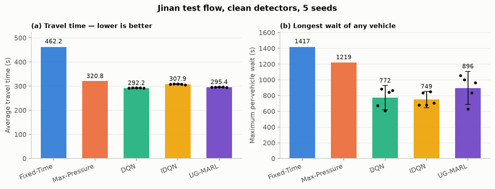

# Figure — main comparison on the Jinan test flow

**Caption.** Five agents on the clean Jinan test flow (`real_2500`, 3600 s, Δt = 15 s). Bars: mean over seeds 0–4; error bars: 95 % CI (Student t); dots: seeds. Fixed-Time and Max-Pressure are deterministic (no error bar). (a) average travel time, (b) maximum per-vehicle wait inside the network.

**Values.** Fixed-Time avg 462.2; Max-Pressure avg 320.8; DQN avg 292.2; IDQN avg 307.9; UG-MARL avg 295.4; Fixed-Time max 1417.0; Max-Pressure max 1219.0; DQN max 772.4; IDQN max 749.2; UG-MARL max 895.8. Source: `results/final/final_test` (= `docs/results/test_main.md`).

**Interpretation.** See `docs/analysis.md` and `notebooks/02_analysis.ipynb`. Attention weights, σ and gate statistics are associations, not causes.
