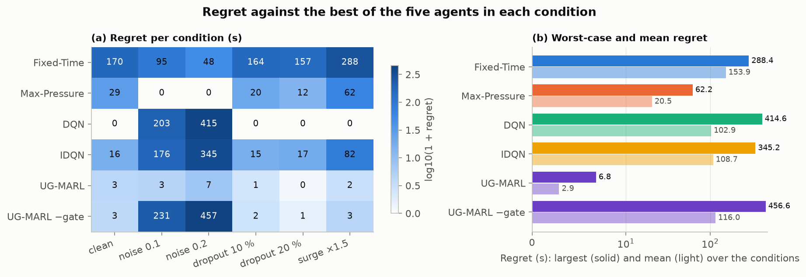

# Figure — regret against the best agent per condition

**Caption.** Regret = a model's mean travel time − the lowest mean among the five agents (Fixed-Time, Max-Pressure, DQN, IDQN, UG-MARL) in the same condition, Jinan test flow, seeds 0–4. (a) per condition (colour on a log scale); (b) each model's largest and mean regret over the six conditions (symmetric-log x axis). Descriptive statistic fixed before the test runs.

**Values.** Fixed-Time: max 288.4 s (surge ×1.5), mean 153.9 s; Max-Pressure: max 62.2 s (surge ×1.5), mean 20.5 s; DQN: max 414.6 s (noise 0.2), mean 102.9 s; IDQN: max 345.2 s (noise 0.2), mean 108.7 s; UG-MARL: max 6.8 s (noise 0.2), mean 2.9 s; UG-MARL −gate: max 456.6 s (noise 0.2), mean 116.0 s.

**Interpretation.** See `docs/analysis.md` and `notebooks/02_analysis.ipynb`. Attention weights, σ and gate statistics are associations, not causes.
