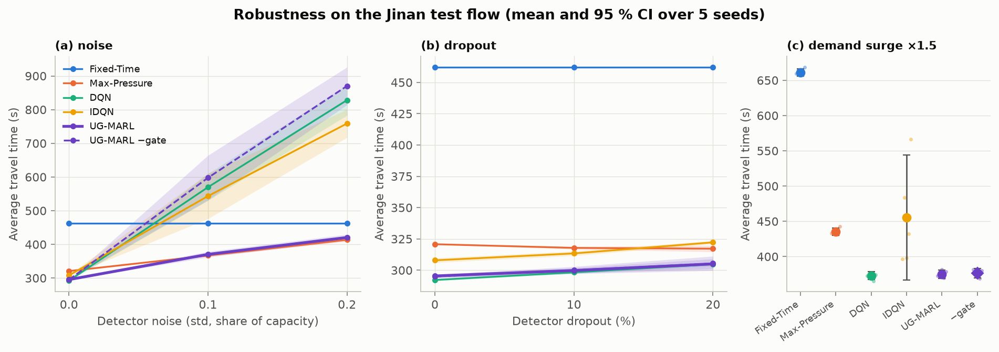

# Figure — robustness to detector noise, dropout and surge

**Caption.** Average travel time on the Jinan test flow as detector noise (a) or dropout (b) grows, and under a demand surge of ×1.5 (c). Lines / points: mean over seeds 0–4; bands / bars: 95 % CI. −gate (dashed) is the same checkpoints as UG-MARL with the gate switched off. Noise and dropout change what the controllers observe, not the traffic; Fixed-Time does not use detectors.

**Values.** Fixed-Time: 462 → 462 → 462; Max-Pressure: 321 → 367 → 414; DQN: 292 → 570 → 828; IDQN: 308 → 543 → 759; UG-MARL: 295 → 370 → 420; UG-MARL −gate: 295 → 598 → 870; Fixed-Time: 462 → 462 → 462; Max-Pressure: 321 → 318 → 317; DQN: 292 → 298 → 305; IDQN: 308 → 313 → 322; UG-MARL: 295 → 300 → 305; UG-MARL −gate: 295 → 300 → 305; Fixed-Time surge 661; Max-Pressure surge 435; DQN surge 373; IDQN surge 455; UG-MARL surge 375; UG-MARL −gate surge 376. Source: `docs/results/test_robustness.md`.

**Interpretation.** See `docs/analysis.md` and `notebooks/02_analysis.ipynb`. Attention weights, σ and gate statistics are associations, not causes.
