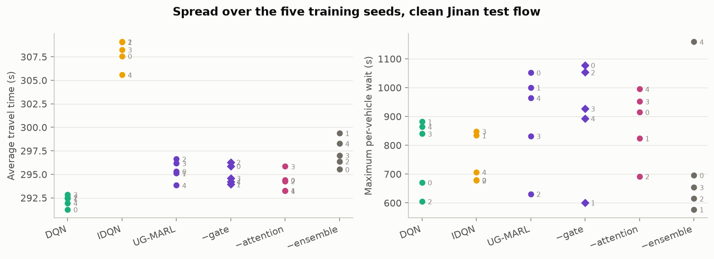

# Figure — spread over training seeds

**Caption.** Every seed's result on the clean Jinan test flow for the learned models (the number next to a point is the seed; seed s = the model trained with seed s). The y axes do not start at 0.

**Values.** DQN avg range 1.6; IDQN avg range 3.5; UG-MARL avg range 2.8; UG-MARL −gate avg range 2.4; UG-MARL −attention avg range 2.6; UG-MARL −ensemble avg range 3.9; DQN max range 277.0; IDQN max range 170.0; UG-MARL max range 421.0; UG-MARL −gate max range 477.0; UG-MARL −attention max range 303.0; UG-MARL −ensemble max range 582.0.

**Interpretation.** See `docs/analysis.md` and `notebooks/02_analysis.ipynb`. Attention weights, σ and gate statistics are associations, not causes.
