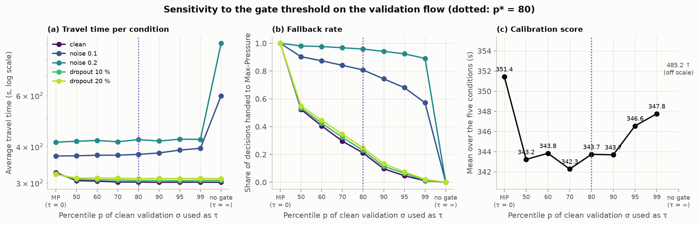

# Figure — sensitivity to the gate threshold τ (validation)

**Caption.** UG-MARL on the Jinan validation flow with τ set to the p-th percentile of each seed-model's clean validation σ, from Max-Pressure (the gate always fires) to the ungated policy; mean over seeds 0–4. (a) travel time per detector condition, (b) fallback rate, (c) the calibration score (mean travel time over the five conditions). p = 50, 60, 70 were added after the final evaluation as a sensitivity check; nothing was re-selected (p* = 80).

**Values.** Score: p max_pressure = 351.4 s, p 50.0 = 343.2 s, p 60.0 = 343.8 s, p 70.0 = 342.3 s, p 80.0 = 343.7 s, p 90.0 = 343.7 s, p 95.0 = 346.6 s, p 99.0 = 347.8 s, p ungated = 485.2 s.

**Interpretation.** See `docs/analysis.md` and `notebooks/02_analysis.ipynb`. Attention weights, σ and gate statistics are associations, not causes.
