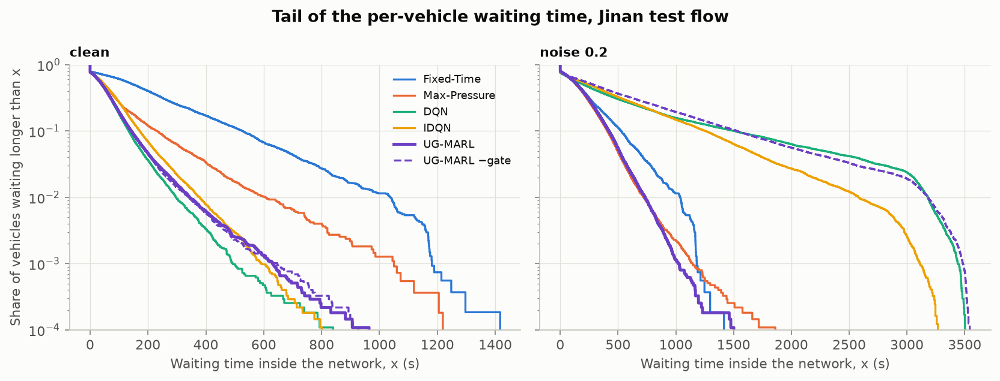

# Figure — tail of the per-vehicle waiting time

**Caption.** Share of vehicles whose total waiting time (seconds at speed < 0.1 m/s inside the network) exceeds x; the five seeds are pooled (log y axis). Waiting outside the network — vehicles that cannot enter a full entry road — is not part of this metric.

**Values.** Fixed-Time / clean: p99 1038 s, max 1417 s; Max-Pressure / clean: p99 606 s, max 1219 s; DQN / clean: p99 297 s, max 882 s; IDQN / clean: p99 379 s, max 848 s; UG-MARL / clean: p99 344 s, max 1052 s; UG-MARL −gate / clean: p99 342 s, max 1078 s; Fixed-Time / noise 0.2: p99 1038 s, max 1417 s; Max-Pressure / noise 0.2: p99 722 s, max 2124 s; DQN / noise 0.2: p99 3181 s, max 3508 s; IDQN / noise 0.2: p99 2582 s, max 3292 s; UG-MARL / noise 0.2: p99 733 s, max 1690 s; UG-MARL −gate / noise 0.2: p99 3182 s, max 3549 s. Source: `vehicles_s*.csv` of `results/final/final_test`.

**Interpretation.** See `docs/analysis.md` and `notebooks/02_analysis.ipynb`. Attention weights, σ and gate statistics are associations, not causes.
