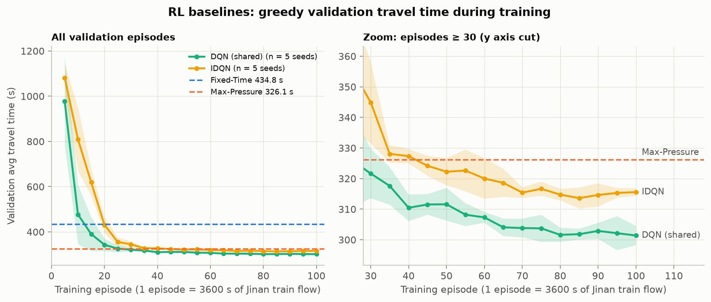

# Figure — RL-baseline learning curves (dev, WSL)

**Caption.** Average travel time (s, lower is better) of the greedy policy on the Jinan validation flow (`real_2000`), evaluated every 5 training episodes. Line = mean over training seeds [0, 1, 2, 3, 4]; band = 95 % CI (Student t). Dashed lines: Fixed-Time and Max-Pressure on the same flow (deterministic). Left: all evaluations; right: the same curves from episode 30 with the y axis cut to the learned agents' range. Generated by `scripts/plot_training.py` from `results/train/<agent>_final_s<seed>/val_log.csv`.

**Values.** DQN (shared): best mean 301.4 s at episode 100, last 301.4 s; IDQN: best mean 313.6 s at episode 85, last 315.6 s; Fixed-Time: 434.8 s (deterministic); Max-Pressure: 326.1 s (deterministic).

**Interpretation.** See worklog/016 (Result) for the reading of this figure.
