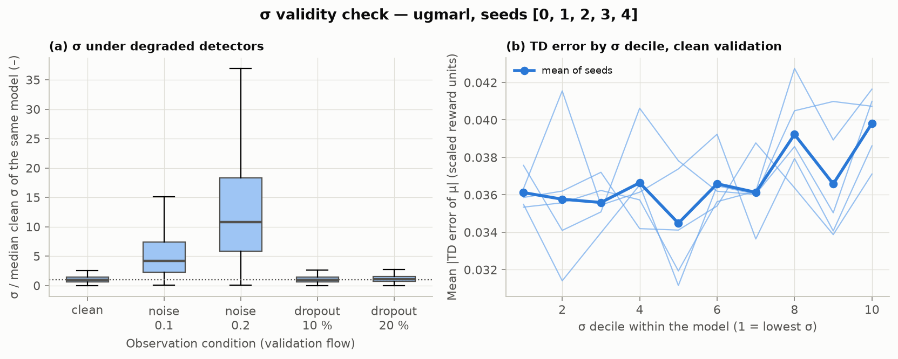

# Figure — σ validity check (ugmarl, validation)

**Caption.** (a) Distribution of σ (ensemble standard deviation of Q at the greedy action) over every decision of one ungated greedy episode per model on the Jinan validation flow, under clean and degraded detectors; σ is divided by the median clean σ of the same model so the five seed-models can be pooled (dotted line = 1). Boxes: quartiles, whiskers 1.5 IQR, outliers hidden. (b) Mean |TD error of the ensemble-mean Q| per σ decile on the transitions of one clean, ungated validation episode per model (thin lines: seeds; thick: mean; the y axis does not start at 0). Generated by `scripts/sigma_check.py --tag final`; native Ubuntu.

**Values.** Median σ / clean median: clean 1.00; noise 0.1 4.18; noise 0.2 10.82; dropout 10 % 1.02; dropout 20 % 1.06. Share of decisions with σ > τ (p* threshold, ungated trajectories): clean 0.200; noise 0.1 0.868; noise 0.2 0.975; dropout 10 % 0.222; dropout 20 % 0.246. Spearman ρ(σ, |TD|) per seed: -0.02, 0.02, 0.05, 0.00, 0.06 (mean 0.03 ± 0.03); mean |TD| in the top σ decile / bottom decile = 1.10.

**Interpretation.** See worklog/017 (Result). These are associations on validation data, not causes; σ is a disagreement between heads that share an encoder, not a calibrated probability of a wrong action.
